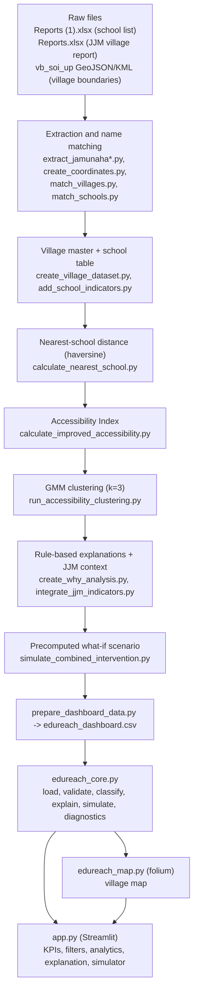

# Methodology

EduReach AI is an exploratory decision-support prototype for **Jamunaha block, Shravasti district, Uttar Pradesh**. Everything below describes what the code in this folder actually does.

## 1. Workflow (actual pipeline)



The order of the data-preparation scripts is inferred from their input and output file names. The full pipeline was **not** re-run from scratch during the final audit; the dashboard was verified from `edureach_dashboard.csv`.

## 2. Accessibility Index

For each village:

```
Accessibility Index = 0.40 x Availability + 0.40 x Proximity + 0.20 x Coverage
```

| Component | Definition | Range |
|---|---|---|
| Availability | 100 if the school list has a school for the village, else 0 | 0 or 100 |
| Proximity | 100 x (1 - nearest_distance / max_distance_in_dataset), clipped | 0-100 |
| Coverage | 25 x PS + 25 x UPS + 30 x Composite + 20 x Madhyamik, capped at 100 | 0-100 |

The weights (40/40/20) are the author's design choices, not estimated from data. The index is a **project-defined exploratory indicator, not a validated or official metric**.

**Normalisation.** Proximity is scaled by the largest distance in this dataset (about 3.3 km), so scores are relative to this block and would change if villages were added.

**Thresholds (single rule used everywhere):** index < 40 = Potential Gap; 40 to < 70 = Moderate (internal); >= 70 = Higher. The dashboard filter shows only the categories present in the data (currently Higher and Potential Gap). The thresholds are project choices.

**What the structure implies.** A village without a recorded school has Availability = 0 and Coverage = 0, so its index is at most 40 x Proximity/100, which is below 40 for every village in this data. A village with a recorded school scores at least 80. Therefore, in this dataset, *Potential Gap = no recorded local school*; the index adds a finer ranking inside each group but not a separate verdict.

## 3. Explainability

The village panel shows each component's raw score, weighted points and maximum points, then sums them. The reconstructed value matches the stored index within rounding (maximum difference 0.005 over all villages; tested). Rule-based text (`Gap_Indicators`, `Travel_Indicator`) comes from fixed rules in `create_why_analysis.py`; it describes observed values and is not a causal explanation.

## 4. GIS and distance

- Village polygons are in a projected CRS (EPSG:7755 in `create_coordinates.py`) and are converted to WGS84; the point used for each village is Shapely's `representative_point()` (a point inside the polygon, not a centroid).
- A school is placed at its village's representative point. There is no separate school survey coordinate.
- Distance is the **haversine (straight-line) distance** between those points. A village that has its own school gets distance 0 by construction.
- No road network, terrain, rivers, seasonal access or travel time is used. Distance must not be read as travel time or real accessibility.
- Map: `edureach_map.py` places one marker per village in [latitude, longitude] order, coloured by status, with a popup and tooltip for the same village (tested).

## 5. Machine learning (unsupervised)

| Item | Value |
|---|---|
| Model | `sklearn.mixture.GaussianMixture`, 3 components, `random_state=42`, other settings default |
| Features (7) | Nearest_School_Distance_km, Has_School, Has_PS, Has_UPS, Has_Composite, Has_Madhyamik, School_Count |
| Preprocessing | `StandardScaler`; no missing values in these features |
| Output | `ML_Cluster` (0, 1, 2) and a manually assigned `ML_Pattern` name |

**Why unsupervised.** There is no ground-truth label (such as "verified inaccessible village"), so there is nothing to predict and accuracy, precision or recall do not apply.

**Cluster profiles (3 clusters):**

| Cluster | Pattern name | Villages | Villages with school | Mean school count | Mean index |
|---|---|---|---|---|---|
| 0 | High Travel-Burden / No Local School | 36 | 0 | 0.00 | 20.34 |
| 1 | Local School - Basic Coverage | 30 | 30 | 1.70 | 86.47 |
| 2 | Local School - Broader Coverage | 49 | 49 | 2.43 | 89.96 |

**Why k = 3.** BIC and AIC kept decreasing from k = 2 to k = 5 (BIC -2837.9, -4155.7, -5203.1, -6011.1). That would favour larger k, but the inputs are mostly 0/1 flags and some Gaussian components shrink to the covariance floor (reg_covar = 1e-6), so these scores cannot be trusted to pick k. k = 3 was kept because the three groups are easy to interpret. It is **not** claimed to be statistically optimal.

**Honest limits.**
- `Has_School` is an input, so cluster 0 is exactly the set of villages with no recorded school. The model mainly adds the split of school villages into Basic vs Broader coverage.
- Reproducibility: refitting the same features with `random_state=42` reproduces the stored labels exactly (tested). Across seeds 0, 7, 21, 42, 99, four give the identical grouping; seed 21 gives a different grouping (Adjusted Rand Index 0.56 against the published one).
- The model is fitted once, offline, on all 115 villages. The dashboard never refits on filtered subsets, so cluster ids keep their meaning when filters change.
- Cluster names were written by hand after reading the profiles; they may need to change if data or features change.

## 6. Intervention scenarios (hypothetical)

All scenarios are **assumptions chosen by the user**, applied to a copy of the data. The source CSV is never written to (tested with a file hash).

- **Connectivity improvement:** closes p% of the remaining Proximity gap: `P' = P + p x (100 - P)`. Availability and Coverage do not change.
- **Hypothetical new local school:** closes p% of the remaining gap in both Availability and Proximity. Coverage is held constant because the level of a new school is not modelled. The percentage is a stand-in for uncertainty about whether a school is built, staffed and used. Capacity, staffing, land, cost and feasibility are **not** modelled.
- **Scope:** by default only villages with no recorded school change; the user can apply the assumption to all villages in the current selection.
- **Index change:** `Scenario index = stored index + 0.40 x dAvailability + 0.40 x dProximity + 0.20 x dCoverage`, clipped to 0-100. At 0% nothing changes.

Results on the current data (computed by `edureach_core.simulate_scenario`, scope = villages without a recorded school):

| Scenario | Assumption | Baseline mean | Scenario mean | Change | Potential Gap villages |
|---|---|---|---|---|---|
| Connectivity improvement | 25% | 67.25 | 68.79 | +1.54 | 36 -> 36 |
| Connectivity improvement | 50% | 67.25 | 70.33 | +3.08 | 36 -> 36 |
| Connectivity improvement | 100% | 67.25 | 73.41 | +6.16 | 36 -> 19 |
| Hypothetical new local school | 25% | 67.25 | 71.92 | +4.67 | 36 -> 24 |
| Hypothetical new local school | 50% | 67.25 | 76.59 | +9.34 | 36 -> 0 |
| Hypothetical new local school | 100% | 67.25 | 85.93 | +18.68 | 36 -> 0 |

These numbers describe the arithmetic of the assumptions, not predicted real-world outcomes. For example, a 100% new-school assumption gives a mean of 85.93, equal to the precomputed `Combined_Accessibility_Index` mean, which was produced by a separate script that places a school in every no-school village.

## 7. Reproducibility

- Dependencies: `requirements.txt` (tested on Python 3.12, Streamlit 1.65.0, pandas 3.0.2, scikit-learn 1.8.0, folium 0.20.0, streamlit-folium 0.27.4).
- Fixed seed (42) for the published clustering; diagnostics use seeds 0, 7, 21, 42, 99.
- `pytest` suite in `tests/` (see `TESTING_REPORT.md`).
